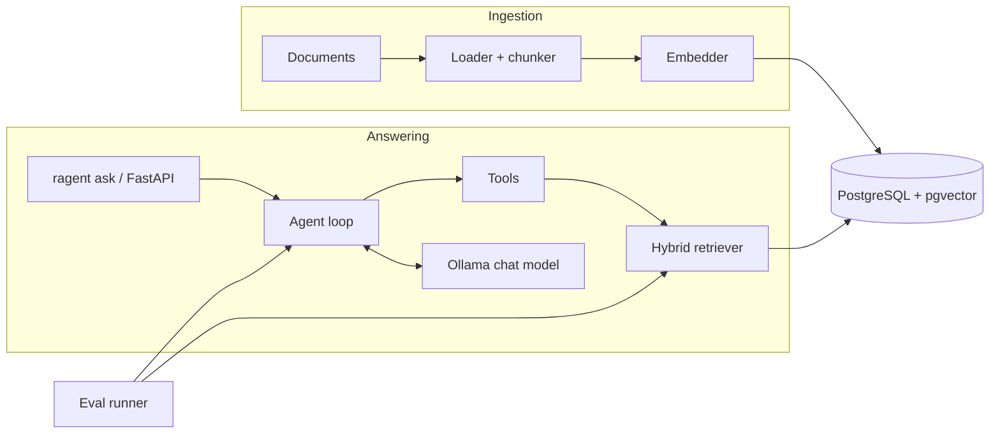

# ragent: an agentic RAG assistant over AWS documentation

A question-answering agent over AWS documentation. It retrieves passages with hybrid
search, answers through a bounded tool-calling loop, cites every claim, and refuses when
the documents do not hold the answer.

Runs locally on [Ollama](https://ollama.com) and PostgreSQL with pgvector. No API key.

> **Status: everything except the container image.** The results table below is empty on
> purpose until the eval runs on a real corpus. What is
> coming and in which order is listed in [docs/PENDING.md](docs/PENDING.md).
> [docs/DESIGN.md](docs/DESIGN.md) and [docs/PLAN.md](docs/PLAN.md) describe the whole
> project, including the parts that have not landed.

## Architecture



| Part | What it does | Code |
| --- | --- | --- |
| Ingestion | Cleans Markdown/HTML, chunks by headings, embeds, stores. Re-runs skip unchanged files. | `src/ragent/ingest` |
| Store | `documents` and `chunks` tables, HNSW index for vectors, GIN index for keywords. | `src/ragent/store`, `db/migrations` |
| Retrieval | Vector search + keyword search, merged with reciprocal rank fusion, then reranked. | `src/ragent/retrieval` |
| Agent | Tool-calling loop with `search_docs`, `get_section`, `compare_services`; stop rules; fixed refusal. | `src/ragent/agent` |
| Guardrails | Input checks, injection scan of retrieved text, citation validation of answers. | `src/ragent/guardrails` |
| Eval | Labelled questions, retrieval and answer metrics, Markdown/JSON reports, CI gate. | `src/ragent/eval`, `evals/` |
| Providers | Ollama embedder and chat model, plus deterministic fakes for tests and CI. | `src/ragent/llm` |

Decisions and their reasons: [docs/DECISIONS.md](docs/DECISIONS.md).

## Quick start

### 1. No model, no database (2 minutes)

```bash
make setup && source .venv/bin/activate
make test            # unit tests
make demo-offline    # full path with fake providers on the sample corpus
make eval-offline    # the retrieval eval that CI runs
```

The offline mode uses a hashed bag-of-words "embedder", a scripted "model" and an
in-memory store. It proves the plumbing works. It says nothing about answer quality.

### 2. The real stack

Needs Docker and Ollama.

```bash
make models          # pulls llama3.1:8b and nomic-embed-text (several GB)
make up              # PostgreSQL with pgvector on localhost:5432
make migrate
make ingest-sample
make ask Q="What happens to a message that is not deleted before the visibility timeout ends?"
make search Q="long polling attribute"
make serve           # then: curl -s localhost:8000/ask -H 'content-type: application/json' \
                     #         -d '{"question": "How many targets can one EventBridge rule have?"}'
ragent -v ask "..."  # also prints the trace line
```

### 3. Your own corpus

```bash
# edit data/sources.yaml, then
make fetch           # downloads pages into data/raw (git-ignored)
make ingest          # ingests data/raw
make chunk-stats     # compares chunking settings on that corpus
make eval            # after you have written evals/dataset.jsonl for that corpus
```

## Configuration

Every setting is an environment variable `RAGENT_<NAME>`; see `.env.example` and
`src/ragent/config.py`. The ones you will change most:

| Variable | Values | Default |
| --- | --- | --- |
| `RAGENT_CHUNK_STRATEGY` / `RAGENT_CHUNK_TOKENS` | `structure` or `fixed` / words per chunk | `structure` / 500 |
| `RAGENT_RETRIEVAL_MODE` | `hybrid`, `vector`, `keyword` | `hybrid` |
| `RAGENT_RERANKER` | `none`, `lexical`, `llm` | `lexical` |
| `RAGENT_TOP_K` | passages given to the model | 5 |
| `RAGENT_CHAT_MODEL` | any Ollama model with tool calling | `llama3.1:8b` |
| `RAGENT_INJECTION_SCAN` | `true`, `false` | `true` |

Changing the chunking settings or the embedding model re-ingests every document on the
next `make ingest`. Changing the embedding size also needs a new migration.

## Evaluation

```bash
ragent eval validate                         # check the dataset file
ragent eval retrieval                        # hit rate, recall, MRR (no chat model)
ragent eval retrieval --mode vector          # compare first-stage modes
ragent eval answers                          # refusal accuracy, coverage, citations, latency
ragent eval answers --single-shot            # plain RAG baseline, no agent
ragent eval answers --judge                  # adds faithfulness (model-judged)
ragent eval answers --dataset evals/injection.jsonl   # attack success rate
```

Dataset format and metric definitions: [evals/README.md](evals/README.md). Experiment
log: [docs/EVAL_REPORT.md](docs/EVAL_REPORT.md). CI fails when the offline retrieval hit
rate on the sample corpus drops below 0.90.

### Results

_State the corpus, the number of questions, the chat model and the date next to every
number._

| Configuration | Hit rate@5 | MRR | Point coverage | Refusal accuracy | p95 latency |
| --- | --- | --- | --- | --- | --- |
| Vector only, no reranker | | | | | |
| Hybrid, no reranker | | | | | |
| Hybrid + reranker (final) | | | | | |

## Limits

- The injection scanner matches known phrasings only. A paraphrase gets through.
- Chunk sizes are counted in words, not model tokens.
- The store opens one connection per query; there is no pool and no cache.
- Answers are only as good as the local model.
- There are no quality numbers on a real corpus yet; the offline numbers only prove the
  plumbing.

## Project layout

```
src/ragent/        the package (config, llm, ingest, store, retrieval, agent, guardrails, api, eval)
tests/unit/        run with no services
tests/integration/ run against PostgreSQL (pytest -m integration)
data/sample/       six short study notes for the offline demo
data/sources.yaml  URLs of the real corpus
evals/             eval datasets and the poisoned fixture
db/migrations/     SQL schema
docs/              PLAN, DESIGN, DECISIONS, WHAT_BROKE, EVAL_REPORT, PENDING
```
