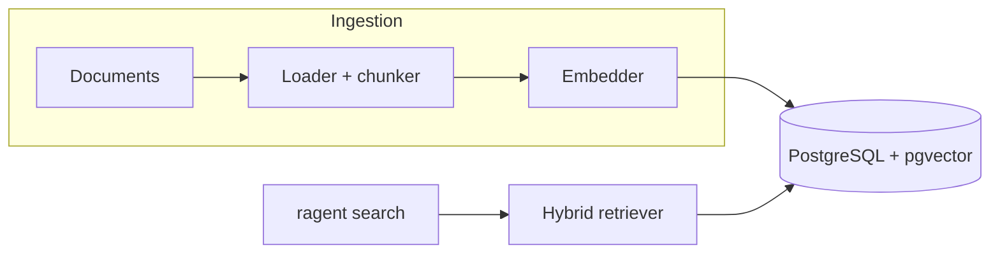

# ragent: hybrid retrieval over AWS documentation

The retrieval core of an agentic RAG assistant. It ingests documents, chunks them by
headings, embeds them, and finds passages with vector search plus keyword search merged
by reciprocal rank fusion and reranked.

Runs locally on [Ollama](https://ollama.com) and PostgreSQL with pgvector. No API key.

> **Status: retrieval core.** This repository holds ingestion, the store and retrieval.
> The agent loop, guardrails, HTTP API and evaluation suite are not here yet; what is
> coming and in which order is listed in [docs/PENDING.md](docs/PENDING.md).
> [docs/DESIGN.md](docs/DESIGN.md) and [docs/PLAN.md](docs/PLAN.md) describe the whole
> project, including the parts that have not landed.

## Architecture



| Part | What it does | Code |
| --- | --- | --- |
| Ingestion | Cleans Markdown/HTML, chunks by headings, embeds, stores. Re-runs skip unchanged files. | `src/ragent/ingest` |
| Store | `documents` and `chunks` tables, HNSW index for vectors, GIN index for keywords. | `src/ragent/store`, `db/migrations` |
| Retrieval | Vector search + keyword search, merged with reciprocal rank fusion, then reranked. | `src/ragent/retrieval` |
| Providers | Ollama embedder and chat model, plus deterministic fakes for tests and CI. | `src/ragent/llm` |

Decisions and their reasons: [docs/DECISIONS.md](docs/DECISIONS.md).

## Quick start

### 1. No model, no database (2 minutes)

```bash
make setup && source .venv/bin/activate
make test            # unit tests
make demo-offline    # retrieval with fake providers on the sample corpus
```

The offline mode uses a hashed bag-of-words "embedder" and an in-memory store. It proves
the plumbing works. It says nothing about retrieval quality.

### 2. The real stack

Needs Docker and Ollama.

```bash
make models          # pulls llama3.1:8b and nomic-embed-text (several GB)
make up              # PostgreSQL with pgvector on localhost:5432
make migrate
make ingest-sample
make search Q="long polling attribute"
ragent search "visibility timeout" --mode keyword
```

### 3. Your own corpus

```bash
# edit data/sources.yaml, then
make fetch           # downloads pages into data/raw (git-ignored)
make ingest          # ingests data/raw
make chunk-stats     # compares chunking settings on that corpus
```

## Configuration

Every setting is an environment variable `RAGENT_<NAME>`; see `.env.example` and
`src/ragent/config.py`. The ones that matter for retrieval:

| Variable | Values | Default |
| --- | --- | --- |
| `RAGENT_CHUNK_STRATEGY` / `RAGENT_CHUNK_TOKENS` | `structure` or `fixed` / words per chunk | `structure` / 500 |
| `RAGENT_RETRIEVAL_MODE` | `hybrid`, `vector`, `keyword` | `hybrid` |
| `RAGENT_RERANKER` | `none`, `lexical`, `llm` | `lexical` |
| `RAGENT_TOP_K` | passages returned | 5 |

The agent and guardrail settings in `config.py` are read by parts that land later.

Changing the chunking settings or the embedding model re-ingests every document on the
next `make ingest`. Changing the embedding size also needs a new migration.

## Limits

- Chunk sizes are counted in words, not model tokens.
- The store opens one connection per query; there is no pool and no cache.
- There are no retrieval quality numbers yet. They come with the evaluation suite.

## Project layout

```
src/ragent/        the package (config, llm, ingest, store, retrieval)
tests/unit/        run with no services
tests/integration/ run against PostgreSQL (pytest -m integration)
data/sample/       six short study notes for the offline demo
data/sources.yaml  URLs of the real corpus
db/migrations/     SQL schema
docs/              PLAN, DESIGN, DECISIONS, WHAT_BROKE, PENDING
```
