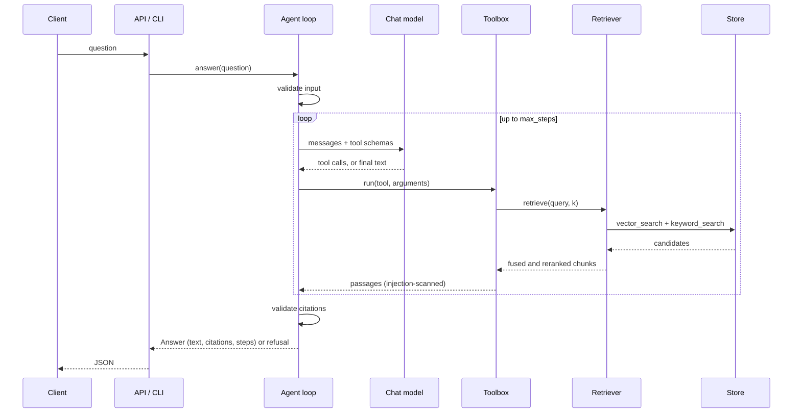

# Design

Technical reference. For the day-by-day work see [PLAN.md](PLAN.md).

## Request flow

## Interfaces

Everything external sits behind a protocol, so tests can swap it.

| Protocol | File | Implementations |
| --- | --- | --- |
| `Embedder` | `llm/base.py` | `OllamaEmbedder`, `FakeEmbedder` |
| `ChatModel` | `llm/base.py` | `OllamaChat`, `ExtractiveChat`, `ScriptedChat` |
| `ChunkStore` | `store/base.py` | `PgVectorStore`, `MemoryStore` |
| `Reranker` | `retrieval/rerank.py` | `NoReranker`, `LexicalReranker`, `LLMReranker` |

`factory.build_container` wires them from `Settings`. The CLI, the API and the eval runner
all go through it.

## Data model

See `db/migrations/001_init.sql`.

- `documents(id, source UNIQUE, title, content_hash, metadata, ingested_at)`
- `chunks(id, document_id, ordinal, section, content, token_count, embedding vector(768), tsv)`
- `tsv` is a generated column over `section || ' ' || content`.
- HNSW index on `embedding` with cosine distance; GIN index on `tsv`.
- A chunk id is `source#ordinal`. It is stable while the document text and the chunking
  settings stay the same.

`content_hash` covers the text, the chunking settings and the embedding model, so a
change to any of them re-ingests the document. Re-ingest replaces all chunks of the
document in one transaction.

## Chunking

| Strategy | How | Trade-off |
| --- | --- | --- |
| `fixed` | Sliding window of N words with overlap | Simple and even, but cuts through sentences, lists and tables |
| `structure` | Split on headings, pack whole paragraphs up to N words; oversized paragraphs fall back to the window | Keeps units of meaning and gives each chunk a heading path; sizes vary a lot |

The text that gets embedded is `title | heading path` plus the chunk content
(`ingest/pipeline.embedding_text`). A 40-word chunk about "Limits" means little without
knowing it sits under "AWS Lambda".

## Retrieval

1. `embed_query` with the `search_query: ` prefix (nomic-embed-text needs task prefixes).
2. Vector top `candidates` (20) by cosine distance.
3. Keyword top 20 by `ts_rank_cd`; the query ORs the question's content words
   (`store/pgvector.build_tsquery`).
4. Reciprocal rank fusion: `score = sum(1 / (60 + rank))` over the lists.
5. Rerank the fused list and keep `top_k` (5).

Score scales differ per reranker (see the docstring of `retrieval/rerank.py`). That
matters for `RAGENT_MIN_RELEVANCE`.

## Agent

- System prompt: `agent/prompts.py`. Tools: `agent/tools.py`. Loop: `agent/loop.py`.
- Stop rules: `max_steps` model turns (6), `max_tool_calls` executed calls (8), identical
  calls are not repeated, tool output capped at `tool_output_chars` (6000).
- `Answer.stop_reason` is one of `answered`, `refused`, `no_citations`, `max_steps`.
  Everything except `answered` returns the fixed refusal sentence.
- `agent/parsing.py` recovers tool calls a model wrote as JSON text.
- `agent/single_shot.py` is plain RAG with the same guardrails, kept as the baseline.

## Guardrails

| Stage | Code | Behaviour |
| --- | --- | --- |
| Input | `guardrails/input.py` | Rejects empty, too long, or control characters (HTTP 422) |
| Retrieved text | `guardrails/injection.py` | Regex scan; matching passages are dropped and counted in `Answer.dropped_passages` |
| Retrieved text | `agent/tools.format_passage` | Wraps content in `<passage>` tags and neutralises a closing tag inside the content |
| Output | `guardrails/output.py` | Keeps only citations of chunks retrieved in this run, strips links not present in those chunks, caps length |

## Observability

`observability/tracing.Tracer` records one span per model call and tool call and emits
one JSON line per question on the `ragent.trace` logger (`ragent -v ask ...`). Replace
`Tracer.emit` to export to OpenTelemetry or Langfuse.

## Testing

- Unit tests need nothing running. They use `MemoryStore`, `FakeEmbedder` and
  `ScriptedChat` (returns canned model responses, so every branch of the loop is tested
  deterministically).
- Integration tests (`pytest -m integration`) run the pgvector store against a real
  database, in CI through a service container.
- The offline retrieval eval is the CI gate.

## What was verified when this scaffold was generated

- Verified by running: unit tests, lint, type check, the offline CLI commands and the
  offline evals.
- Not run (no network, database or model in the build environment): `PgVectorStore`,
  the migration, `OllamaChat`, `OllamaEmbedder`, the FastAPI app and its tests,
  `scripts/fetch_docs.py`, the Dockerfile, Docker Compose and the GitHub Actions workflow.
  Expect to fix small things there on days 1, 2 and 12, and log them in `WHAT_BROKE.md`.
